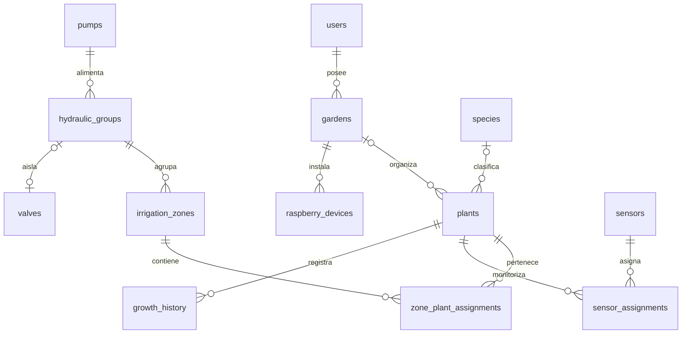

> **Cierre autorizado de 3.2E.4 — 2026-11-10.** Hito Git v0.3.5;
> creación de commit y publicación en origin/main autorizadas, publicación pendiente
> de comprobación. Se conservan las limitaciones documentadas. E.5 no iniciada ni
> autorizada. Los estados de preparación anteriores quedan como trazabilidad.

# Estado actual E.4 (2026-11-10)

Ocho escritores REST usan un gateway SECURITY DEFINER; Python conserva adaptación,
autenticación y transacción, SQL decide CAS/estado y confirma datos/recibos/grupos.
Las lecturas no unen nombres derivados de jardines/especies: las representaciones
individuales dependen solo de campos almacenados cubiertos por revisión; los hechos
son inmutables. No hay endpoints sync ni integración Flutter.
Implementación y validación técnica completadas; cierre Git pendiente.
Desarrollo migrado conjuntamente hasta 0005_mutation_gateway y comprobado READ ONLY;
sin despliegue persistente ni CRUD HTTP en desarrollo. Ver
[sus resultados](sync/e4-validation-results.md),
[contrato REST](resources-api.md) y [migración y límites](sync/e4-deployment.md).

El resto conserva decisiones y antecedentes de 3.2A–D; sus referencias a escritores
Python y permisos anteriores quedan sustituidas para E.4 por los documentos enlazados.

# Arquitectura aprobada — backend E.4 en revisión

Este documento describe el destino de la arquitectura. En Fase 3.2B se implementan
solo users, gardens, species, plants, growth_history y watering_events con
PostgreSQL/SQLAlchemy/Alembic; los detalles efectivos están en [database.md](database.md).
Fase 3.2C añade autenticación, sesiones, límites de intentos y separación de roles
([authentication.md](authentication.md)). Fase 3.2D añade la API REST de
jardines, plantas, especies y registros históricos ([resources-api.md](resources-api.md)).
El resto sigue siendo diseño: no hay
sincronización, agentes Raspberry Pi ni accionamiento de salidas. Liveness sigue
independiente de la conexión PostgreSQL.

## Separación y compatibilidad

Flutter conserva su dominio, controladores compartidos, almacenamiento local,
UUID y comportamiento offline de v0.2.0. Sus archivos y sus 263 pruebas no se
modifican en esta fase. El backend es un proyecto hermano, no un subproyecto
Flutter. No depende de Firebase, Supabase ni otros servicios de backend.

El backend será un monolito modular:

| Paquete | Responsabilidad futura |
| --- | --- |
| `core` | Configuración y aspectos transversales. |
| `db` | Sesiones y transacciones PostgreSQL, y contexto de propietario. |
| `modules/health` | Vida del proceso HTTP. |
| `modules/auth` | Identidad, sesiones y autorización. |
| `modules/gardens` | Instalaciones lógicas y pertenencia de recursos. |
| `modules/plants` | Plantas, especies y crecimiento. |
| `modules/watering` | Registros manuales e historial. |
| `modules/devices` | Vinculación y credenciales de dispositivos. |
| `modules/telemetry` | Sensores y mediciones reales. |
| `modules/irrigation` | Zonas, grupos, válvulas, bombas, políticas y órdenes. |
| `modules/sync` | Operaciones idempotentes y cambios incrementales. |

Los paquetes reservados contienen solo su descripción: no publican endpoints
vacíos ni simulan prestaciones. Cuando se implementen, las rutas validarán DTO,
los servicios aplicarán reglas/transacciones y los repositorios accederán a SQL.
Flutter y Raspberry Pi usarán HTTPS/REST; no recibirán credenciales PostgreSQL.

## Instalaciones: `gardens`

Se elige el nombre **gardens** para una instalación o ubicación lógica, no
necesariamente un jardín exterior. Campos previstos: `id UUID`, `owner_id`,
`name`, descripción opcional, zona horaria IANA opcional, revisión y fechas.
**No se exigen coordenadas geográficas.**

Un usuario tiene cero o varias instalaciones. Una planta puede no tener jardín
asignado inicialmente; los dispositivos futuros pertenecerán a una instalación. Zonas, bombas, válvulas y sensores deben pertenecer al mismo
jardín que los dispositivos/asignaciones de los que dependen. Claves foráneas
compuestas impedirán referencias cruzadas entre jardines y propietarios.
No se implementa todavía colaboración entre usuarios.

Una futura vinculación de datos offline puede crear un jardín predeterminado
con autorización del usuario, conservando IDs. No obliga a crear cuentas para
usar el modo local. Los traslados físicos cerrarán asignaciones históricas y no
reescribirán los registros anteriores; la política de traslado entre jardines
se concretará antes de implementar esa operación.

## Modelo relacional preliminar

Todos los IDs de entidad son UUID. Los instantes usan `timestamptz`, se transportan
como UTC con offset y no dependen del reloj del teléfono para ordenar revisiones.

| Entidad | Campos y relaciones previstos |
| --- | --- |
| `users` | Identidad, email normalizado, hash de contraseña, estado. |
| `auth_sessions` | Usuario, hash de refresh token, rotación, vencimiento y revocación. |
| `client_installations` | Instalación de la app, usuario vinculado, plataforma y cursor; no confundir con un jardín o una Raspberry Pi. |
| `gardens` | Instalación lógica, propietario y nombre. |
| `plants` | Jardín, nombre, `species_id` opcional, texto libre de especie, frecuencia en días, fecha inicial de último riego, revisión y borrado lógico. |
| `species` | Catálogo opcional: nombre científico/común, descripción y fuente. No contiene la configuración particular de una planta. |
| `growth_history` | Planta, `measured_at`, `recorded_at`, `height_m` opcional, `diameter_m` opcional, tipo de diámetro y notas. |
| `raspberry_devices` | Jardín, propietario, identidad física, estado y versión de configuración. |
| `device_credentials` | Credencial individual hasheada, dispositivo, caducidad/revocación. |
| `device_output_channels` | Dispositivo, canal físico y capacidades; evita asignar un relé como bomba y válvula simultáneamente. |
| `pumps` | Jardín, dispositivo/canal, límites continuos y acumulados, separación entre arranques y estado seguro. |
| `valves` | Jardín, dispositivo/canal, estado seguro, realimentación y revisión. |
| `hydraulic_groups` | Bomba, coordinador, válvula de aislamiento opcional y revisión hidráulica validada. |
| `irrigation_zones` | Grupo hidráulico, jardín, nombre y estado. La bomba se deriva del grupo. |
| `zone_plant_assignments` | Zona, planta y periodo de asignación. |
| `sensors` | Jardín, dispositivo/canal, tipo, unidad y estado. No se exige un sensor por planta. |
| `sensor_assignments` | Sensor, planta y periodo histórico de asignación. |
| `sensor_calibrations` | Sensor, parámetros y versión de calibración. |
| `moisture_measurements` | UUID de muestra, sensor/asignación, valor bruto, humedad opcional calibrada, calidad, fecha de medición/recepción. |
| `zone_automation_policies` | Grupo efectivo, revisión, habilitación, umbrales, cobertura, frescura, histéresis y límites. |
| `automation_policy_inputs` | Política y asignaciones de sensores que la alimentan. |
| `watering_commands` | Zona solicitada, grupo efectivo, actor, duración autorizada, emisión/vencimiento, revisión hidráulica, estado y token de ejecución. |
| `watering_command_targets` | Instantánea de zonas, plantas y asignaciones afectadas. |
| `command_events` | Reporte único, orden, dispositivo, secuencia, fechas, resultado y evidencia. |
| `watering_events` | Registros manuales actuales; los tipos de hardware posteriores se versionarán explícitamente. Nombre histórico, fecha e ID estable de planta. |
| `execution_resources` | Recursos exclusivos: bomba, alimentación o circuito incompatible. |
| `execution_resource_reservations` | Reserva de recursos por una orden; los estados inciertos no se liberan solo por timeout. |
| `sync_operations` | Operación, propietario, hash de solicitud y resultado idempotente. |
| `sync_changes` | Revisión confirmada por propietario y conjunto transaccional de cambios. |
| `audit_log` | Actor, acción sensible, recurso y resultado, sin secretos. |

### Altura y diámetro sin duplicación

`growth_history` conserva **altura y diámetro independientemente opcionales**.
Las dimensiones presentes deben ser finitas y positivas; una medición dimensional
requiere al menos una. El tipo de diámetro (por ejemplo, tallo o copa) debe quedar
identificado cuando se mida, para no comparar magnitudes diferentes.

La altura actual puede ser una proyección de la última medición válida. La altura
existente en Flutter sin fecha de medición se conserva como valor inicial, sin
inventar una entrada histórica. Flutter actualmente no registra diámetro: no se
crean valores ni se amplía su modelo en esta fase. Si se materializa una altura
actual por rendimiento, no será una segunda fuente editable independiente.

La frecuencia particular pertenece a la planta; la política automática, a la
unidad hidráulica; y la calibración, al sensor. Elegir una especie no sobrescribe
esas decisiones. El texto libre de especie actual se preservará durante una
migración futura, incluso cuando no exista coincidencia con el catálogo.

### Cardinalidades e integridad

- Una zona puede contener una o varias plantas. Una zona vacía solo es borrador.
- Propuesta inicial: una sola zona activa por planta, con múltiples asignaciones
  a lo largo de su historia; la planta puede no tener zona ni sensor.
- Un sensor individual tiene como máximo una planta asignada en un instante;
  una planta puede tener varios sensores. Los periodos exclusivos no se solapan.
- Una bomba puede alimentar varios grupos/zonas. Sin aislamiento independiente,
  las zonas acopladas se ejecutan como un solo grupo y comparten política efectiva.
- Tres escenarios cubiertos: bomba de una planta; bomba de varias plantas juntas;
  bomba de varias zonas aisladas mediante electroválvulas.
- Una configuración mixta con ramales abiertos y otros valvulados no se habilita
  como independiente sin validación física. No basta un booleano del cliente.
- Bomba y válvulas pueden tener distintos controladores en el modelo, pero la
  ejecución distribuida queda deshabilitada hasta verificar coordinación segura.
- El nombre de planta no es único. Se conserva frecuencia entera 1–36500 días.
- Borrado lógico: no eliminar en cascada crecimiento ni historial de riegos.
- Para historial importado de plantas ya eliminadas: referencia FK opcional y
  UUID histórico original separado, sin inventar plantas para satisfacer una FK.

## Órdenes y automatización (diseño; sin ejecución)

Las órdenes se dirigen a zonas. El servidor resuelve el grupo y las zonas/plantas
realmente afectadas; el usuario confirma ese alcance y la revisión hidráulica.
No se aceptan pines arbitrarios ni una bomba elegida por el cliente fuera de esa
relación. `202 Accepted` significa solo orden registrada.

Estados propuestos: `queued -> claimed -> running -> succeeded | failed | unknown`,
y `expired`/`cancelled` donde corresponda. `expires_at` es el límite para iniciar;
una ejecución iniciada tiene además un plazo monotónico máximo y una autorización
local vigente. El vencimiento se comprueba al recibir, reclamar y antes de actuar.
No se extiende al reintentar. Una orden vieja no se ejecuta al reconectar.

Una misma orden conserva UUID y resultado ante reintentos. El agente futuro
necesitará un registro durable antes de accionar. Si el resultado físico es
incierto tras un reinicio, no se repite automáticamente ni se libera la bomba
solo porque venció una reserva. Inicialmente solo una orden activa por bomba,
con reservas adicionales para circuitos o alimentación incompatibles.

La automatización será explícita y desactivada hasta validar instalación,
sensores y calibraciones. Incluye cobertura, entradas seleccionadas, umbral de
inicio/parada con histéresis, antigüedad y calidad de mediciones, duración máxima,
separación entre arranques y presupuesto acumulado. Sin datos válidos no inicia;
si dejan de ser válidos durante una ejecución, se aplica parada segura. No se
supone que una lectura represente todas las plantas sin aceptación explícita.
El backend decide órdenes y el coordinador aplica seguridad local: no habrá dos
planificadores independientes mandando la misma bomba.

## Confirmación del controlador frente a entrega de agua

Son ejes distintos, no un único booleano de éxito:

| Eje | Ejemplos de estado | Qué demuestra |
| --- | --- | --- |
| `controller_execution_status` | pending, running, completed, failed, unknown | El controlador reportó la ejecución y el estado de sus salidas. |
| `delivery_verification_status` | not_measured, verified, failed, inconclusive | Existe o no evidencia física de entrega de agua. |

Un reporte `completed` con entrega `not_measured` se muestra como **ciclo reportado
por el controlador**, no como agua físicamente verificada. La verificación requiere
evidencia de instrumentación adecuada (por ejemplo caudal), su sensor, calibración
y fechas. La lectura de un GPIO o el acuse de una válvula no prueban caudal.
Sin evidencia no se inventan litros ni se transforma `null` en cero.

La propuesta conservadora para una fase futura es no actualizar un "último riego
físicamente verificado" a partir de un mero acuse del controlador. La regla de
incorporación al calendario se aprobará antes de habilitar hardware. Hoy el
calendario e historial de Flutter siguen basados únicamente en registros manuales.
Un registro manual no genera una orden de bomba ni confirma entrega instrumentada.

## Condiciones de apagado seguro

Estos son requisitos de diseño y puesta en servicio, **no garantías implementadas**:

| Condición | Respuesta exigida al futuro coordinador |
| --- | --- |
| Arranque, reinicio o actualización | Salidas en estado seguro, bomba desactivada; no reproducir órdenes almacenadas. |
| Orden vencida, revisión obsoleta o reloj no fiable | No iniciar y reportar rechazo. |
| Válvula requerida no confirmada o circuito no validado | No arrancar bomba. El nivel de confirmación debe corresponder al riesgo físico. |
| Duración máxima, presupuesto o interbloqueo incumplido | Parar localmente aunque el servidor no responda. |
| Pérdida de comunicación/autorización o watchdog | Aplicar parada local; no depender de recibir un mensaje remoto de apagado. |
| Datos de sensores requeridos ausentes, obsoletos o inválidos | No iniciar; detener una ejecución automática que pierda sus condiciones de seguridad. |
| Fallo de caudal, presión, nivel u otra protección instalada | Parar y bloquear nuevos arranques según el fallo. No asumir que existe instrumentación que no se instaló. |
| Estado de salida o resultado incierto | Marcar unknown, mantener bloqueo y requerir reconciliación o inspección autorizada. |

La secuencia normal propuesta es abrir la ruta validada, confirmar las condiciones
necesarias, arrancar bomba y, al detener, apagar bomba antes del cierre de válvulas.
Los tiempos, descarga de presión y respuesta de emergencia deben validarse para
la hidráulica real; no se asume una secuencia universal contra golpe de ariete.
Válvulas normalmente cerradas y bomba sin energía como estado seguro se usarán
solo si son apropiadas y verificadas en la instalación. Un relé pegado o un sifón
pueden requerir corte/aislamiento independientes: software solo no los garantiza.
Se requieren límites locales y protección física independiente cuando corresponda.

## Sincronización y seguridad futuras

La unidad transaccional local futura debe reunir datos, operaciones pendientes y
cursor. La sincronización no enviará jardines completos para reemplazarlos a
ciegas. UUID/operation_id estables, revisiones y tombstones evitarán duplicación
y resurrección por ediciones offline. Eventos antiguos no retroceden el último
riego. No se crean eventos ficticios a partir de fechas antiguas. Se conserva
la regla de periodos de 86400 segundos y las fechas locales para hoy/mañana.

Usuarios y dispositivos tendrán credenciales y permisos separados; toda relación
se valida por propietario y jardín. PostgreSQL será privado, las conexiones REST
usarían HTTPS y el backend administraría límites, revocación y auditoría. La autenticación y separación de roles se concretan en authentication.md;
los mecanismos de dispositivos y sincronización permanecen pendientes.

## Referencias de diseño

- [FastAPI: aplicaciones modulares](https://fastapi.tiangolo.com/tutorial/bigger-applications/)
- [FastAPI: configuración](https://fastapi.tiangolo.com/advanced/settings/)
- [PostgreSQL: restricciones](https://www.postgresql.org/docs/current/ddl-constraints.html)
- [PostgreSQL: bloqueos](https://www.postgresql.org/docs/current/explicit-locking.html)
